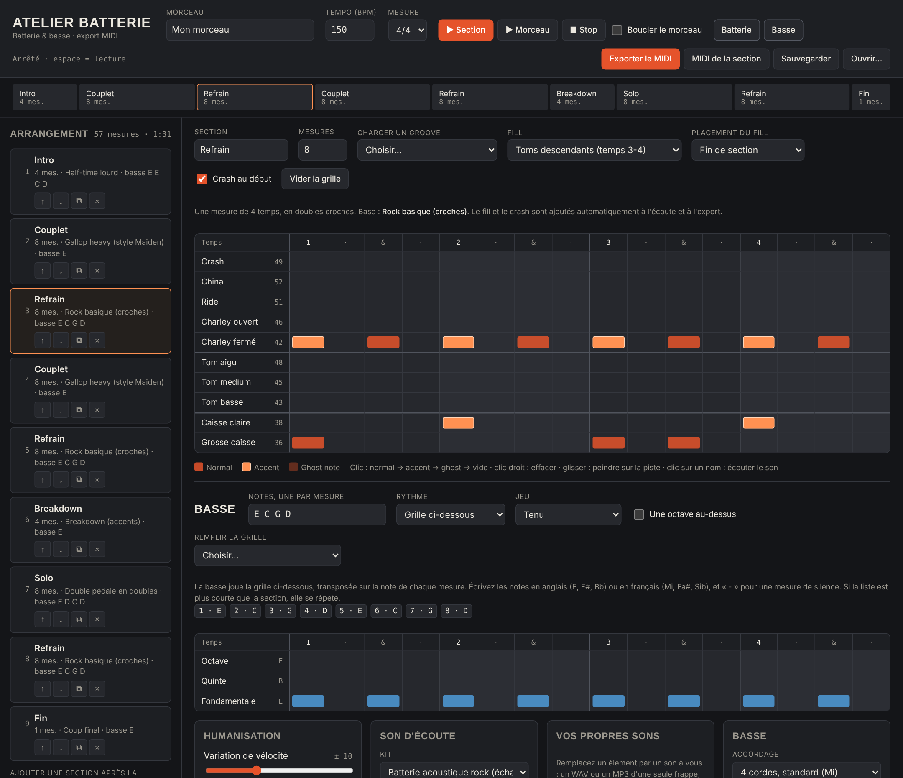

# 🥁 Atelier Batterie

**Séquenceur de batterie et de basse rock & metal qui tourne dans le navigateur.** Vous construisez la section rythmique d'un morceau section par section, vous l'écoutez avec un vrai kit acoustique et une basse, puis vous l'exportez en MIDI vers votre logiciel de musique (Cakewalk, Reaper, Cubase, Ableton…).

Il n'y a rien à installer : tout tient dans un seul fichier HTML, sons compris.

👉 **[Essayer en ligne](https://ornitho13.github.io/drums-atelier/)**

---

## Pourquoi ?

Les boucles de batterie, celles d'une pédale d'effet ou d'une boîte à rythmes, tournent vite en rond : le même motif d'un bout à l'autre du morceau, sans break, sans montée, sans fill. Un vrai batteur change de groove entre couplet et refrain, place des fills avant les changements et frappe plus ou moins fort.

Atelier Batterie sert à écrire ce genre de partie rapidement, avec une ligne de basse calée dessus, pour des maquettes guitare rock et metal.

## Fonctionnalités

- **Arrangement par sections** : intro, couplet, refrain, pont, solo, breakdown, fin… Les sections se déplacent, se dupliquent et se suppriment, avec la durée totale du morceau calculée en direct.
- **13 grooves prêts à l'emploi** : rock, hard rock, half-time, gallop façon Maiden, double pédale (en croches ou en doubles), skank beat thrash, blast beat, breakdown, intro calme, coup final…
- **Fills automatiques** : roulements, toms descendants, tour de toms, double pédale et toms, coups synchronisés. On les place en fin de section ou toutes les 2, 4 ou 8 mesures.
- **Crash automatique** au début des sections et après chaque fill.
- **Grille pas à pas en doubles croches**, avec trois niveaux de frappe : normal, accent et ghost note. On peut aussi « peindre » au glisser, pratique pour caler la grosse caisse sur un riff.
- **Mesures en 3/4, 4/4, 5/4, 6/4 et 7/4.**
- **Humanisation** : variations de force et léger décalage rythmique, avec une option pour garder la grosse caisse parfaitement calée, comme on le fait en metal.
- **Kit acoustique échantillonné**, avec 3 niveaux de frappe par élément, et des sons synthétiques en alternative.
- **Réverb réglable** : type (pièce, studio live, grande salle, plate), niveau, durée et pré-délai, avec une option pour laisser la grosse caisse sans réverb.
- **Vos propres sons** : vous pouvez remplacer n'importe quel élément du kit par un WAV ou un MP3 à vous.
- **Export MIDI** du morceau entier ou d'une seule section, tempo et mesure inclus : un fichier pour la batterie (canal 10), un pour la basse (canal 1) et un fichier complet à deux pistes.
- **Correspondance des notes MIDI modifiable**, pour s'adapter à votre plugin de batterie.
- **Partie basse** pour chaque section :
  - les notes s'écrivent une par mesure, en anglais (`E C G D`) ou en français (`Mi Do Sol Ré`), avec `-` pour un silence ;
  - trois modes de rythme : suivre la grosse caisse (fills compris), jouer une grille pas à pas (fondamentale, quinte, octave), ou rester en silence ;
  - des grilles toutes faites : croches, doubles croches, gallop, noires, blanches, rondes, octaves, fondamentale-quinte-octave, copie de la grosse caisse ;
  - deux façons de jouer, étouffé (palm mute) ou tenu, et une option pour monter d'une octave ;
  - plusieurs accordages (standard, drop D, un ton plus bas, drop C, 5 cordes) et trois sons d'écoute (aux doigts, au médiator, saturée).
- **Boutons pour couper** la batterie ou la basse à l'écoute.
- **Sauvegarde du projet** en `.json`, plus une sauvegarde automatique dans le navigateur.

## Utilisation

### En ligne

Ouvrez la page GitHub Pages du projet, ou téléchargez `index.html` et double-cliquez dessus. Le fichier fonctionne aussi hors ligne.

### Raccourcis

| Action | Geste |
|---|---|
| Lecture / arrêt de la section | `Espace` |
| Ajouter une frappe, puis passer de normal à accent, ghost note et vide | Clic sur une case |
| Effacer une frappe | Clic droit |
| Remplir plusieurs cases d'une même piste | Cliquer-glisser |
| Écouter un élément du kit | Clic sur son nom |

### Importer dans Cakewalk (ou un autre logiciel de musique)

1. Cliquez sur **Exporter le MIDI**. Le `.zip` contient `…-batterie.mid`, `…-basse.mid` et `…-complet.mid` (les deux pistes dans un seul fichier).
2. Dans votre logiciel, insérez votre plugin de batterie (EZdrummer, Superior Drummer, Steven Slate Drums, MT Power Drum Kit, GetGood Drums…) et votre plugin de basse en pistes **instrument**.
3. Glissez chaque `.mid` sur la piste MIDI du bon plugin, au début du projet. Le tempo est inclus dans les fichiers.
4. Retouchez si besoin dans le piano roll : chaque section commence sur une nouvelle mesure.

Les notes suivent le standard **General MIDI**, reconnu par la plupart des plugins :

| Élément | Note | Élément | Note |
|---|---|---|---|
| Grosse caisse | 36 | Tom aigu | 48 |
| Caisse claire | 38 | Tom médium | 45 |
| Charley fermé | 42 | Tom basse | 43 |
| Charley ouvert | 46 | Crash | 49 |
| Ride | 51 | China | 52 |

Si votre plugin utilise une autre correspondance, modifiez-la dans le panneau **Notes MIDI de votre kit**.

## Technique

- Un seul fichier `index.html`, en HTML, CSS et JavaScript, sans framework ni dépendance.
- Le son passe par la **Web Audio API** : lecture d'échantillons avec plusieurs niveaux de frappe, basse synthétisée par un modèle de corde pincée (Karplus-Strong), réverb à convolution générée par le code, compresseur sur la sortie.
- Les fichiers MIDI (formats 0 et 1, 480 PPQ) sont écrits directement dans le navigateur.
- Le projet fonctionne dans les navigateurs récents : Chrome, Edge, Firefox et Safari.

## Pistes d'amélioration

- [ ] Shuffle et triolets (12/8, gallop en triolets)
- [ ] Piste de click / métronome
- [ ] Charley au pied et rimshot
- [ ] Import d'une piste guitare pour jouer par-dessus
- [ ] Plusieurs variations de groove dans une même section
- [ ] Basse : notes de passage, glissés et accords personnalisés

Les contributions et suggestions sont les bienvenues : ouvrez une issue ou une pull request.

## Crédits et licence

- **Échantillons de batterie** : [GMRockKit](https://github.com/hydrogen-music/hydrogen/tree/master/data/drumkits/GMRockKit) de Glen MacArthur et Sebastian Moors, du projet [Hydrogen](http://hydrogen-music.org/), sous licence GPL. La china est dérivée de la crash.
- **Code** : © Jérôme Debray.

Ce projet est distribué sous licence **GNU GPL v3.0** : voir le fichier [`LICENSE`](LICENSE).
